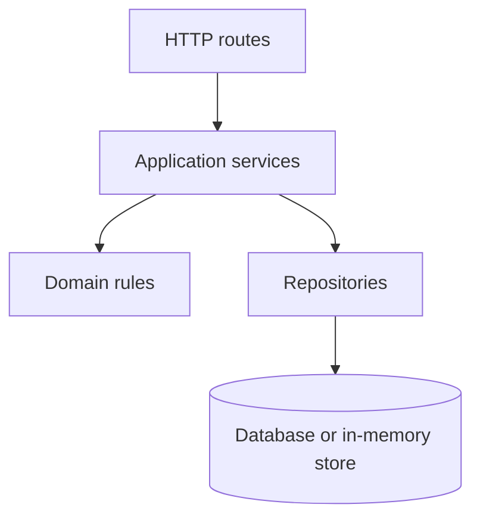
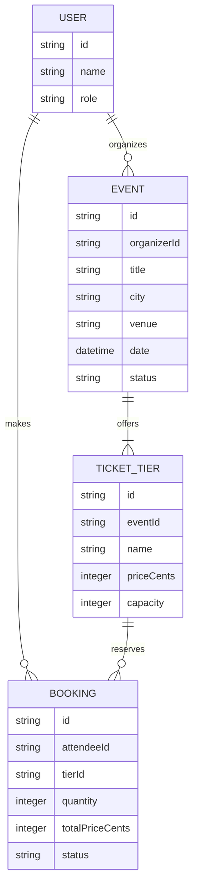
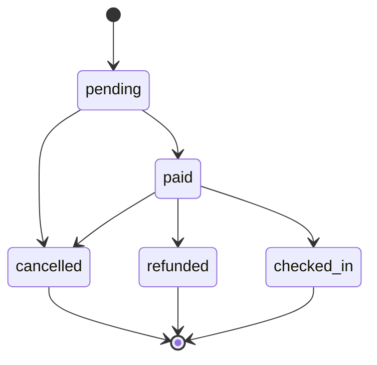

# Build 3 architecture

## Layers

- **Routes** translate HTTP requests and responses; they do not contain business rules or access storage directly.
- **Services** coordinate use cases and repositories; they do not implement transport details or bypass domain rules.
- **Rules** enforce domain behavior and state transitions; they do not know about HTTP or persistence.
- **Repositories** load and save data; they do not make business decisions or call routes/services.
- **Data** is the persisted or in-memory state; it does not initiate calls into other layers.

## Data model

## Booking life cycle

`cancelled`, `refunded`, and `checked_in` are terminal states. No transition is permitted out of them.
