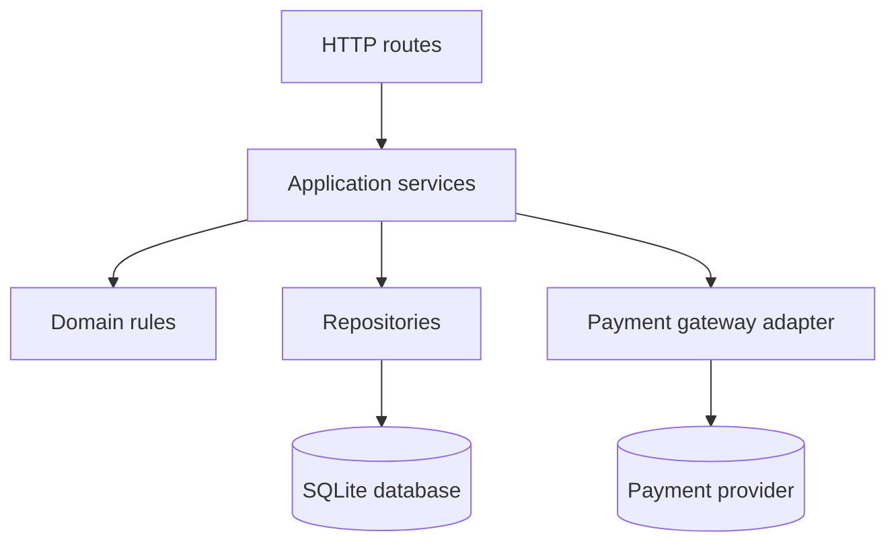
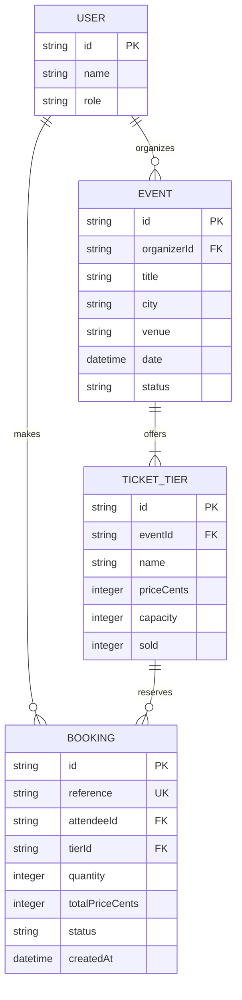
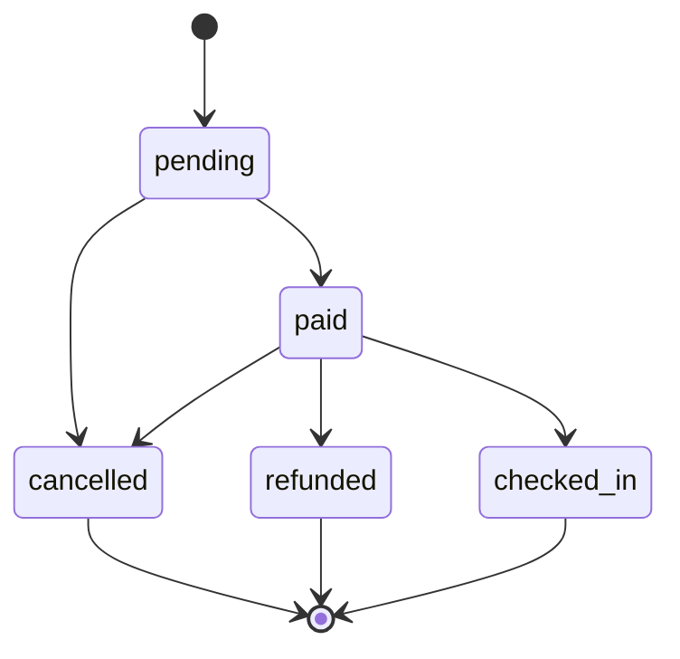

# Build 3 architecture

## Layers



- **Routes** translate HTTP requests and responses; they do not contain business rules or access storage directly.
- **Services** coordinate use cases and repositories; they do not implement transport details or bypass domain rules.
- **Rules** enforce domain behavior and state transitions; they do not know about HTTP or persistence.
- Shared input validation lives in `src/domain/validation.js`; HTTP routes call it before forwarding validated values to services.
- **Repositories** load and save data; they do not make business decisions or call rules, services, or routes.
- **Gateways** adapt external systems for service use; they do not own booking rules or persistence.
- **Data** is the persisted or in-memory state; it does not initiate calls into other layers.

## Data model



## Booking life cycle



`cancelled`, `refunded`, and `checked_in` are terminal states. No transition is permitted out of them.

## Build 5 persistence and capacity

The server is the composition root: it injects the SQLite repository and mock
payment gateway into the HTTP router and services. The memory repository is
available for isolated tests. Services coordinate domain rules and repository
operations; repositories contain only data access and atomic persistence
operations. `ticket_tiers.sold` is constrained to stay between zero and
capacity. Booking reserves tickets with one parameterized conditional update:

```sql
UPDATE ticket_tiers
SET sold = sold + ?
WHERE id = ? AND sold + ? <= capacity
```

Exactly one changed row means the reservation succeeded. No changed row means
the requested seats are no longer available.
